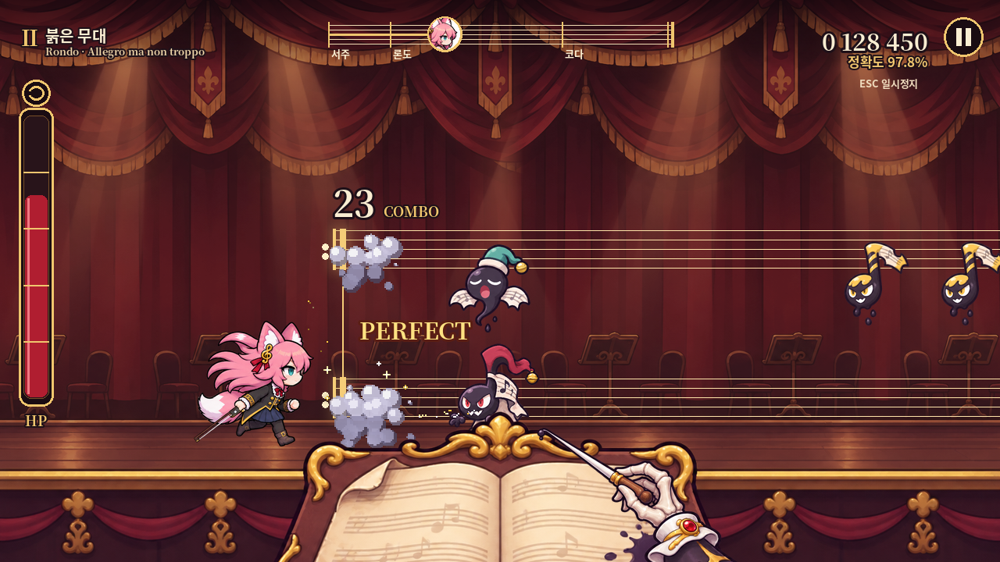

# TUK-2DGP-Rondo-Fox

생상스 「서주와 론도 카프리치오소」로 플레이하는 횡스크롤 리듬 게임 (Python · pico2d, 2D 게임 프로그래밍 텀 프로젝트)



*플레이 화면 예시 (시안). F로 위 줄, J로 아래 줄 적을 벰. 판정 위치는 오선 위의 금색 겹세로줄.*

- 세계관·설정: [docs/rondo_fox_world_setting.md](docs/rondo_fox_world_setting.md)
- 에셋 규격: [rondo_fox_assets/ASSETS.md](rondo_fox_assets/ASSETS.md)

## 실행

```
pip install pico2d
python main.py
```

지금은 1스테이지(서주)까지 플레이할 수 있음.

| 키 | 동작 |
|---|---|
| F | 위 줄 적 베기 |
| J | 아래 줄 적 베기 (롱노트는 끝까지 누르고 있기) |
| ESC / 오른쪽 위 버튼 | 일시정지 (R 다시 시작, Q 끝내기) |
| SPACE | 시작 대사 넘기기 |
| [ / ] | 음악과 노트가 어긋날 때 싱크 보정 (0.01초씩) |

## 코드 구성

| 파일 | 내용 |
|---|---|
| main.py | 실행 시작점 |
| game_framework.py / game_world.py | 모드 전환, 레이어별 오브젝트 관리 |
| play_mode.py | 플레이 화면: 채보 읽기, 입력 판정, 클리어·실패 처리 |
| pause_mode.py / result_mode.py | 일시정지, 결과 화면 |
| song.py | 스테이지 정보, 채보 로딩, 음악 시계 |
| fox.py | 여우 상태 기계 (대기·달리기·베기·롱노트·피격·쓰러짐·승리) |
| notes.py | 적(노트)과 롱노트(붙임줄) |
| stage_scene.py | 배경, 오선·판정선, 피트, 지휘자 손 |
| hud.py | HP, 진행도, 점수·정확도, 콤보 |
| effects.py | 타격 이펙트, 판정 글자 |
| assets.py | 이미지·시트·글자 로딩 |
| config.py | 화면 배치, 판정 범위 등 수치 |

