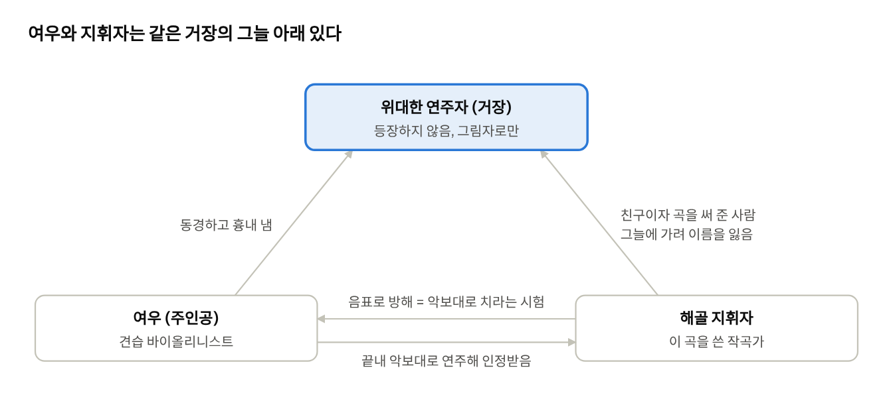

# Rondo Fox 세계관·설정 문서

Nov 6, 2026 · @yeon dang

## 개요

위대한 연주자를 동경하는 견습 바이올리니스트 여우가, 그 연주자의 그늘에 가려 살았던 해골 지휘자의 방해를 뚫고 생상스 「서주와 론도 카프리치오소」를 끝까지 연주하는 리듬 러너 게임이다.

- **장르:** 횡스크롤 리듬 러너 (2라인: SPACE 점프로 공중 노트, J 공격으로 지상 노트, 공중에서 J로 금빛 연타 노트)
- **곡의 실제 사연 (모티프):** 생상스가 친구이자 당대 최고의 바이올리니스트였던 사라사테를 위해 쓴 곡이다. 박수는 연주자가 받고, 곡을 쓴 사람은 그 뒤에 선다. 게임은 이 구도를 가상의 인물로 옮긴다. 게임 안에서는 실명을 쓰지 않는다.
- **주제:** 동경하는 사람을 흉내 내는 것에서 벗어나 자기 소리를 찾는 이야기. 주인공과 악역이 모두 같은 사람의 그늘 아래 있다.

## 인물과 관계

세 인물은 모두 한 사람, 위대한 연주자를 중심으로 묶여 있다. 지휘자는 여우를 무조건 미워하는 게 아니라, 여우에게서 자기 모습을 본다.

두 사람의 화살표가 모두 거장을 향하고, 마지막에는 둘 사이의 화살표로 이야기가 끝난다.

| 인물 | 정체 | 원하는 것 | 화면에서 |
| --- | --- | --- | --- |
| 여우 (주인공) | 거장의 공연을 보고 음악을 시작한 견습 바이올리니스트. 칼처럼 휘두르는 것은 바이올린 활 | “그분처럼” 연주하는 것. 처음에는 거장의 화려한 꾸밈까지 흉내 냄 | 플레이어 캐릭터 |
| 위대한 연주자 (거장) | 여우가 동경하는 바이올리니스트. 이미 무대를 떠났거나 세상을 떠났음 | (등장하지 않음) | 2스테이지부터 무대 뒤 그림자로만 |
| 해골 지휘자 (악역) | 거장의 가장 오랜 친구이자 이 곡을 써 준 작곡가. 곡은 거장의 이름으로 유명해졌고, 죽어서도 지휘봉을 놓지 못함 | 자기 곡이 “자기가 쓴 대로” 연주되는 것을 듣는 것 | 피트에서 오른손만. 얼굴은 끝까지 안 나옴 |

**지휘자가 방해하는 이유** — 두 감정이 섞여 있다.

- **열등감:** 거장을 흉내 내는 소리가 옛 상처를 건드린다. “또 그 사람의 연주냐.”
- **시험:** 그가 소환하는 잉크 음표는 거장이 생략하거나 바꿔 연주했던 원래 악보의 음들이다. 전부 쳐내라는 건 “내가 쓴 대로 쳐 봐라”는 요구다.
- **거울:** 여우는 흉내 내느라 자기 연주를 잃고 있고, 지휘자는 그늘에 가려 자기 이름을 잃었다. 둘 다 같은 사람의 그림자다.

## 스테이지별 이야기 흐름

곡의 구간이 바뀔 때마다 지휘자의 태도가 한 단계씩 바뀌고, 마지막 구간에서 방해를 멈추고 함께 지휘한다.

| 스테이지 | 곡 구간 | 이야기 | 지휘자 연출 |
| --- | --- | --- | --- |
| 1. 객석 | 서주 (Andante malinconico) | 여우가 무대에 오름. 지휘자는 “또 흉내쟁이군” 하며 시큰둥하게 음표를 던짐 | 특수 몹이 나올 때만 가끔 휘저음 |
| 2. 붉은 무대 | 론도 (Allegro ma non troppo) | 여우가 버티자 지휘자가 진지해짐. 무대 뒤로 거장의 그림자가 드리우고, 지휘자가 이 곡을 쓴 사람이라는 게 드러남 | 휘젓기가 잦아지고 잉크가 거세짐 |
| 3. 금빛 무대 | 클라이맥스와 코다 | 여우가 흉내를 버리고 악보대로, 자기 소리로 연주하기 시작함 | 코다에서 방해를 멈추고 처음으로 함께 지휘함 |

**엔딩:** 곡이 끝나면 지휘자가 지휘봉을 내려놓는다. 잉크가 걷히고 거장의 그림자도 사라진다. 여우는 거장의 모방자가 아니라 자기 이름의 연주자가 되고, 지휘자는 마침내 자기 곡이 제대로 연주되는 것을 듣는다.

**실패 시:** HP가 0이 되면 지휘자의 시큰둥한 한마디 후 재시작 화면으로 간다. 여우는 쓰러짐 모션(fox_fall)을 쓴다.

## 대사 초안

대사는 스테이지 시작·전환·엔딩에만 짧게 넣는다. 플레이 중에는 대사를 띄우지 않는다. 지휘자의 대사는 피트 쪽에서 나오는 자막으로, 얼굴 없이 표시한다.

| 시점 | 누가 | 대사 |
| --- | --- | --- |
| 1스테이지 시작 | 여우 | “그분이 연주하던 곡이야. 나도 그분처럼…!” |
| 1스테이지 시작 | 지휘자 | “또 그자의 흉내인가. 지겨운 소리다.” |
| 2스테이지 시작 | 지휘자 | “아무도 모른다. 이 악보를 누가 썼는지.” |
| 2스테이지 시작 | 여우 | “이 곡… 당신이 쓴 거야?” |
| 3스테이지 시작 | 지휘자 | “그자처럼 치지 마라. 악보를 봐라. 거기 다 적혀 있다.” |
| 3스테이지 시작 | 여우 | “그분 말고… 내 소리로.” |
| 엔딩 | 지휘자 | “그 곡은 그렇게 치는 거다.” |
| 엔딩 | 여우 | “다음엔 함께 무대에 서 주세요, 지휘자님.” |
| 실패 | 지휘자 | “그 정도로는 그자의 그림자조차 못 된다.” |

## 게임 시스템과의 연결

점수의 기준을 “거장과의 일치도”에서 “악보 정확도”로 바꾼다. 이렇게 하면 이야기와 점수가 같은 것을 말한다. 목표는 흉내가 아니라 정확함이다.

| 시스템 | 규칙 | 이야기에서의 의미 |
| --- | --- | --- |
| 판정 | PERFECT ±50ms (300점, HP +1) · GOOD ±100ms · MISS (HP −10, 공중 연타는 −5) | 악보에 적힌 박자대로 친 정도 |
| 콤보 배율 | 10콤보 ×1.1 · 30콤보 ×1.2 · 50콤보 ×1.5 | 여우가 흐름을 타면 지휘자가 더 거세게 반응함 |
| 악보 정확도 | 결과 화면의 대표 수치 = PERFECT 비율 | “내가 쓴 대로 쳤는가”에 대한 지휘자의 평가 |
| 셈여림 버프 (선택) | 구간별로 ff / p / dim. 표시. 지시에 맞는 구간에서 점수 보너스 | 작곡가가 악보에 적어 둔 의도 |
| 지휘자 휘젓기 | 특수 몹이나 롱노트 등장 약 0.35초 전에만 재생 | 지휘자가 직접 음표를 던지는 순간 |

채보는 처음부터 끝까지 곡의 실제 박에 맞춘다. 고정 BPM 대신 음표마다 시간(초)을 적는 방식을 쓴다. 서주는 느리고 템포 변화가 있기 때문이다.

## 화면 구성과 연출

화면은 위쪽 무대와 아래쪽 오케스트라 피트로 나뉜다. 카메라는 피트에 선 지휘자의 눈이다. 그래서 배경이 흘러가도 피트와 손은 화면에 고정된다.

| 요소 | 값 (1280×720 기준) |
| --- | --- |
| 배경 | 0.74배, 위로 41px 올려 그림. 노트 속도의 약 0.4배로 횡스크롤 |
| 피트 난간 | 화면 위에서 y = 600 (아래 120px가 피트) |
| 캐릭터 발 | pico2d 기준 y = 147 |
| 판정선 | x = 430. 여우는 x = 330 |
| 지휘자 손 | 0.5배, 소매 끝을 화면 (900, 아래 밖 40px)에. 평소에는 1.5px 숨쉬기만 |
| 노트 이동 | 시간 기반. 노트 x = 판정선 + (노트 시간 − 곡 시간) × 속도 |

**타격감 연출 (코드로 구현)**

- 히트스톱 0.07초, 맞는 적에 흰색 플래시(_flash 시트), 화면 흔들림 최대 6px·0.16초
- 타격 섬광(fx_hit_spark), 잉크 파티클, 판정 글자와 콤보 팝업
- 지휘자가 휘저을 때 지휘봉 끝에서 잉크가 무대 오른쪽으로 날아가고, 거기서 몹이 등장

## 에셋 현황

필수 그림 에셋은 모두 완성됐고, rondo_fox_assets.zip 하나에 들어 있다. 칸 크기, 프레임 순서, 재생 시간, 기준점은 묶음 안의 ASSETS.md에 있다.

| 분류 | 파일 | 상태 |
| --- | --- | --- |
| 여우 동작 | fox_run, fox_jump, fox_air, fox_ground, fox_hit, fox_fall, fox_idle, fox_victory, fx_slash_ground | 완료 |
| 적 | enemy_ink(지상), rest_ghost(공중), gold_grace(공중 연타), 각각 _flash 포함 | 완료 |
| 이펙트 | fx_hit_spark | 완료 |
| 배경 | bg_stage1(객석), bg_stage2(붉은 무대), bg_stage3(금빛 무대), 가로 반복 타일 | 완료 |
| 지휘자 | conductor_sweep(휘젓기), pit_foreground(보면대·난간) | 완료 |
| 지휘자 (선택) | conductor_summon(크게 찌르는 소환, 보스급 연출용) | 보관 |
| 거장의 그림자 (선택) | 2스테이지부터 무대 뒤에 깔리는 반투명 실루엣 | 미제작 |
| 참고용 | fox_face_ref, conductor_hand_ref (GPT 재생성 시 첫 번째로 첨부, 게임에는 안 들어감) | 완료 |

폐기한 시안: conductor_beat4(4박 지휘), conductor_left4(왼손), conductor_flick(작게 까딱이는 손짓).

## 챙겨야 할 것

그림 다음으로 가장 큰 일은 음원과 채보다. 게임의 재미가 여기서 결정되고, 시간도 가장 많이 든다.

**음악**

- [ ] 음원 확보: 곡 자체는 저작권이 끝났지만, 녹음본은 따로 권리가 있다. 퍼블릭 도메인 녹음을 찾거나 MIDI로 직접 만들고, 출처를 기록해 둔다
- [ ] 곡 길이 정하기: 전곡은 대략 9분 안팎이라 게임 한 판으로는 길다. 스테이지당 1\~2분으로 자를 구간을 정한다
- [ ] 채보 제작 도구: 음악을 틀어 놓고 키를 누른 시간을 기록하는 작은 스크립트를 먼저 만든다. 손으로 시간을 하나씩 적는 것보다 훨씬 빠르다
- [ ] 싱크 오프셋 보정: 컴퓨터마다 소리가 나오는 지연이 다르다. OFFSET 값을 설정에서 조절할 수 있게 한다
- [ ] 효과음: 타격, MISS, 콤보, 지휘자 휘젓기 소리 (아직 없음)

**화면과 UI (아직 없음)**

- [ ] 타이틀, 결과(악보 정확도·등급), 일시정지, 실패 화면
- [ ] HP 바, 점수·콤보 표시, 판정 글자, 대사 자막 상자
- [ ] 한글 폰트: 무료 배포 폰트를 쓰고 라이선스를 확인한다
- [ ] (선택) 거장의 그림자 실루엣
